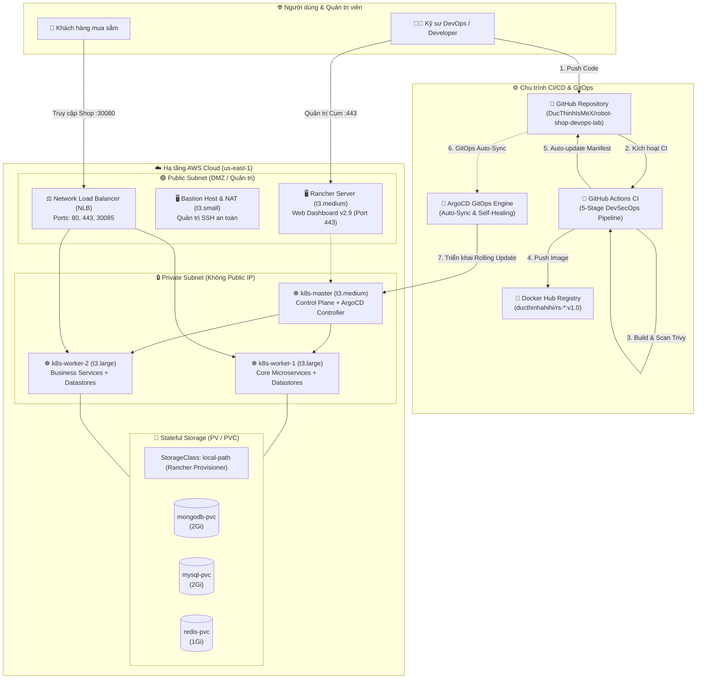

# BÁO CÁO TIẾN ĐỘ THỰC HIỆN ĐỒ ÁN CHUYÊN NGÀNH
## ĐỀ TÀI: TRIỂN KHAI VÀ TỰ ĐỘNG HÓA VẬN HÀNH HỆ THỐNG MICROSERVICES (STAN'S ROBOT SHOP) TRÊN ĐÁM MÂY AWS VỚI KUBERNETES, RANCHER VÀ QUY TRÌNH DEVOPS GITOPS

---

* **Sinh viên thực hiện:** Đức Thịnh
* **Môi trường hạ tầng:** AWS Cloud (us-east-1) - AWS Academy Learner Lab
* **Kho mã nguồn dự án (GitHub):** [DucThinhIsMeX/robot-shop-devops-lab](https://github.com/DucThinhIsMeX/robot-shop-devops-lab)
* **Kho chứa Container Image (Docker Hub):** [hub.docker.com/u/ducthinhahihi](https://hub.docker.com/u/ducthinhahihi)
* **Thời gian cập nhật:** Tháng 11/2026

---

## 1. TỔNG QUAN KIẾN TRÚC HỆ THỐNG ĐÃ XÂY DỰNG

### 1.1. Kiến trúc Tổng thể Chu trình DevOps & Hạ tầng AWS Cloud

Hệ thống được thiết kế và triển khai hoàn chỉnh theo mô hình **Cloud-Native & GitOps Enterprise**, kết hợp giữa nền tảng điều phối container hàng đầu (**Kubernetes**), hệ thống quản trị trực quan (**Rancher Dashboard**), và chu trình tự động hóa khép kín (**GitHub Actions CI + ArgoCD GitOps CD**).



---

### 1.2. Mô hình Triển khai Mạng & Điều phối Pods trong Cụm Kubernetes (Kubernetes Ingress & Multi-Node Pod Architecture)

Mô hình triển khai chi tiết bên trong Cụm Kubernetes mô phỏng chuẩn xác kiến trúc điều hướng lưu lượng tầng L7 (Ingress $\rightarrow$ Service $\rightarrow$ Multi-Node Pods), kết hợp mô hình **API Gateway Pattern** và **Tự động co giãn Pods (HPA)** trên các máy chủ tính toán (**Worker Nodes**):


```mermaid
flowchart TB
    Client["🌐 Internet Traffic / Người dùng"] -->|Cổng 80 HTTP / 443 HTTPS| NLB["⚖️ AWS Network Load Balancer (NLB)\n(Public Subnet)"]

    subgraph K8s_Cluster ["☸️ Kubernetes Cluster (Private Subnet - VXLAN Calico CNI)"]
        NLB -->|Chuyển tiếp L7| Ingress["🚪 Traefik Ingress Controller\n(networking.k8s.io/v1)"]
        
        Ingress -->|Path: / (Prefix)| Svc_Web["🔀 Service: web\n(NodePort 30080 / Port 8080)"]

        subgraph Layer_Gateway ["🌐 Tầng API Gateway & Reverse Proxy (Nginx)"]
            Svc_Web --> Pod_Web1["📦 Pod web-1\n(Worker 1)"]
            Svc_Web --> Pod_Web2["📦 Pod web-2\n(Worker 2 - HPA)"]
        end

        subgraph Core_Services ["⚙️ Tầng Dịch vụ Nghiệp vụ (Kubernetes Services Layer)"]
            Svc_Cat["🔀 Svc: catalogue (:8080)"]
            Svc_Cart["🔀 Svc: cart (:8080)"]
            Svc_User["🔀 Svc: user (:8080)"]
            Svc_Pay["🔀 Svc: payment (:8080)"]
            Svc_Ship["🔀 Svc: shipping (:8080)"]
            Svc_Rate["🔀 Svc: ratings (:80)"]
            Svc_Disp["🔀 Svc: dispatch (:8080)"]
        end

        Pod_Web1 -->|/api/catalogue/| Svc_Cat
        Pod_Web1 -->|/api/cart/| Svc_Cart
        Pod_Web1 -->|/api/user/| Svc_User
        Pod_Web1 -->|/api/payment/| Svc_Pay
        Pod_Web1 -->|/api/shipping/| Svc_Ship
        Pod_Web1 -->|/api/ratings/| Svc_Rate

        subgraph Worker_Nodes ["🖥️ Phân bổ Pods trên các Máy chủ Worker Nodes (High Availability)"]
            subgraph Node1 ["k8s-worker-1 (10.0.11.21)"]
                Pod_Web1
                Pod_Cat1["📦 catalogue Pod 1"]
                Pod_Cart1["📦 cart Pod 1"]
                Pod_User1["📦 user Pod 1"]
                Pod_Rate1["📦 ratings Pod 1"]
                Pod_Disp1["📦 dispatch Pod 1"]
                Pod_Mongo[("💾 mongodb Pod\n(mongodb-pvc 2Gi)")]
                Pod_Redis[("⚡ redis Pod\n(redis-pvc 1Gi)")]
            end

            subgraph Node2 ["k8s-worker-2 (10.0.11.22)"]
                Pod_Web2
                Pod_Cat2["📦 catalogue Pod 2 (HPA)"]
                Pod_Cart2["📦 cart Pod 2 (HPA)"]
                Pod_Pay1["📦 payment Pod 1"]
                Pod_Ship1["📦 shipping Pod 1"]
                Pod_MySQL[("🗄️ mysql Pod\n(mysql-pvc 2Gi)")]
                Pod_Rabbit[("📬 rabbitmq Pod\n(Message Broker)")]
            end
        end

        %% Điều phối cân bằng tải liên Node (Cross-Node Load Balancing)
        Svc_Cat -->|Round-Robin| Pod_Cat1
        Svc_Cat -->|Round-Robin| Pod_Cat2
        Svc_Cart -->|Round-Robin| Pod_Cart1
        Svc_Cart -->|Round-Robin| Pod_Cart2
        Svc_Pay --> Pod_Pay1
        Svc_Ship --> Pod_Ship1

        %% Giao tiếp CSDL & Lưu trữ
        Pod_Cat1 -.-> Pod_Mongo
        Pod_Cat2 -.-> Pod_Mongo
        Pod_Cart1 -.-> Pod_Redis
        Pod_Cart2 -.-> Pod_Redis
        Pod_Ship1 -.-> Pod_MySQL
        Pod_Pay1 -.-> Pod_Rabbit
    end
```

#### Phân tích Chi tiết Cơ chế Điều phối Lưu lượng:
1. **Cổng vào Đám mây (AWS NLB):** Đón toàn bộ traffic Internet tại Public Subnet và phân phối an toàn vào các cổng của cụm K8s nằm trong Private Subnet (chống tấn công trực tiếp vào máy chủ).
2. **Ingress Controller (Traefik):** Hoạt động ở tầng L7 (HTTP/HTTPS), tiếp nhận request gửi tới domain/IP và định tuyến theo luật Ingress ([K8s/05-ingress/ingress.yaml](file:///c:/Users/Duc%20Thinh/Documents/Học%20tập/Đồ%20án%20chuyên%20ngành/robot-shop-devops-lab/K8s/05-ingress/ingress.yaml)) vào Service `web`.
3. **Mô hình API Gateway & Path-based Routing:** Pod `web` đóng vai trò kép: vừa phân phối giao diện tĩnh (HTML/AngularJS), vừa là API Gateway (Nginx Reverse Proxy) phân giải các URL có tiền tố `/api/<service>/` tới các K8s ClusterIP Services tương ứng.
4. **Cân bằng tải Đa Node (Multi-Node Load Balancing):** Các Kubernetes Services sử dụng iptables/IPVS để cân bằng tải (Round-Robin) tới các Pod nằm rải rác trên cả 2 máy chủ `k8s-worker-1` và `k8s-worker-2`. Điều này đảm bảo tính sẵn sàng cao (**High Availability**): nếu một worker gặp sự cố, worker còn lại vẫn duy trì ứng dụng bình thường.
5. **Cơ chế Co giãn Tự động (Horizontal Pod Autoscaler - HPA v2):** Khi lưu lượng người dùng tăng cao, HPA tự động nhân rộng số lượng Pod từ 1 lên đến 5 Pods và phân bổ đồng đều lên các Node, ngăn chặn tắc nghẽn cục bộ.
6. **Lưu trữ Trạng thái Bền vững (Stateful Storage):** Các cơ sở dữ liệu (`mongodb`, `mysql`, `redis`) được gắn kết với Persistent Volume Claims (PVC) thông qua Rancher Local-Path Provisioner, đảm bảo an toàn dữ liệu kể cả khi Pod bị tái khởi động.

---

## 2. CHI TIẾT TIẾN ĐỘ VÀ KẾT QUẢ ĐÃ ĐẠT ĐƯỢC

### 🏁 Chặng 1: Khảo sát, Sửa lỗi mã nguồn & Đóng gói Docker Images (100% Hoàn thành)
* **Khảo sát hệ thống:** Hệ thống Stan's Robot Shop gồm 10 microservices đa ngôn ngữ (Polyglot) với cơ chế lưu trữ phân tán (**Polyglot Persistence**):
  * `web`: Nginx + AngularJS.
  * `catalogue` & `user`: Node.js (kết nối MongoDB).
  * `cart`: Node.js (kết nối Redis).
  * `shipping`: Java Spring Boot (kết nối MySQL).
  * `ratings`: PHP (kết nối MySQL).
  * `payment`: Python (kết nối RabbitMQ).
  * `dispatch`: Golang (kết nối RabbitMQ).
* **Khắc phục các lỗi mã nguồn gốc:**
  1. *Ratings build failure:* Sửa lỗi Debian Bullseye mirror 404 trong `ratings/Dockerfile`.
  2. *Dispatch build failure:* Khắc phục lỗi `package slices not in GOROOT` bằng cách nâng cấp base image từ `golang:1.17` lên `golang:latest`.
  3. *MySQL/Web execution errors:* Sửa lỗi định dạng ngắt dòng Windows CRLF (`\r\n` $\rightarrow$ `\n`) và cấp quyền thực thi `chmod +x entrypoint.sh`.
* **Kết quả:** Đã build thành công và phát hành toàn bộ **10 Docker Images** lên Docker Hub cá nhân:
  * `ducthinhahihi/rs-web:v1.0`
  * `ducthinhahihi/rs-catalogue:v1.0`
  * `ducthinhahihi/rs-cart:v1.0`
  * `ducthinhahihi/rs-user:v1.0`
  * `ducthinhahihi/rs-shipping:v1.0`
  * `ducthinhahihi/rs-payment:v1.0`
  * `ducthinhahihi/rs-ratings:v1.0`
  * `ducthinhahihi/rs-dispatch:v1.0`
  * `ducthinhahihi/rs-mongodb:v1.0`
  * `ducthinhahihi/rs-mysql:v1.0`

---

### 🏁 Chặng 2: Thiết kế Hạ tầng theo mã (IaC - Terraform & Ansible) (100% Hoàn thành)
* **Mô hình mạng chuẩn bảo mật doanh nghiệp (Multi-tier VPC):**
  * Tách biệt **Public Subnet (`10.0.1.0/24`)** và **Private Subnet (`10.0.11.0/24`)**.
  * Cụm Kubernetes (Master và 2 Worker) nằm hoàn toàn trong Private Subnet, **không có Public IP**, loại bỏ 100% rủi ro bị tấn công trực tiếp từ Internet.
  * Máy chủ `edge` đóng vai trò kép: **NAT Gateway** (cấp Internet cho private subnet) và **Bastion Jump Server** (SSH ProxyJump an toàn).
* **Tích hợp máy chủ quản trị Rancher Server:**
  * Khai báo EC2 `rancher-server` (`t3.medium`, 30GB gp3) trong Public Subnet, tự động cài đặt Docker và chạy container `rancher/rancher:latest`.
* **Cân bằng tải công khai (AWS NLB):**
  * Mở 3 cổng định tuyến vào mạng nội bộ: Cổng `80` (Web Shop), `443` (HTTPS Traefik), `30085` (ArgoCD Web Dashboard).
* **Tự động hóa với Ansible:**
  * Tự động cài đặt Kubernetes `v1.31`, Containerd, CNI Calico (VXLAN mode), Metrics-server, Traefik Ingress và ArgoCD.
  * Tối ưu hóa: Loại bỏ hoàn toàn phụ thuộc vào AWS ECR để không bị lỗi hết hạn token của AWS Learner Lab, chuyển sang dùng Docker Hub cá nhân `ducthinhahihi`.

---

### 🏁 Chặng 3: Triển khai Microservices lên Cụm Kubernetes (100% Hoàn thành)
* Đã cấu hình và triển khai đầy đủ các tài nguyên K8s trong namespace `robot-shop`:
  * **Cấu hình & Bí mật:** `robot-shop-config` (ConfigMap 14 tham số) và `robot-shop-secret` (Secret 7 mật khẩu kết nối DB).
  * **Cơ sở dữ liệu & Hàng đợi:** MongoDB (`27017`), MySQL (`3306`), Redis (`6379`), RabbitMQ (`5672`, `15672`).
  * **Các dịch vụ nghiệp vụ:** Catalogue, User, Cart, Shipping, Payment, Ratings, Dispatch.
  * **API Gateway & Giao diện:** Pod `web` được expose ra ngoài bằng NodePort `30080`.
* **Kiểm chứng thực tế:**
  * Website bán hàng hoạt động trơn tru: `http://<worker-ip>:30080`.
  * Các API tương tác dữ liệu hoạt động chính xác: API `/api/catalogue/categories` trả về dữ liệu danh mục robot lưu trong MongoDB: `["Artificial Intelligence","Robot"]`.

---

### 🏁 Chặng 4: Triển khai Hệ thống GitOps với ArgoCD (100% Hoàn thành)
* **Cài đặt & Vận hành:** Cài đặt toàn bộ bộ điều khiển ArgoCD trên namespace `argocd`, mở cổng Web Dashboard qua NodePort `30085`.
* **Tạo Application `robot-shop`:** Kết nối ArgoCD với kho GitHub `DucThinhIsMeX/robot-shop-devops-lab`, theo dõi thư mục `K8s/` với cơ chế quét đệ quy (`directory.recurse = true`).
* **Khắc phục lỗi xung đột hạ tầng:**
  * Sửa lỗi xung đột `spec.selector is immutable` do nhãn cũ của Rancher.
  * Giải phóng cổng `30080` bị giữ bởi Service cũ.
* **Kết quả:** Trạng thái ứng dụng trên ArgoCD đạt **`Synced` & `Healthy` (Xanh lá 100%)**. Kích hoạt thành công 2 tính năng cao cấp:
  * **Auto-Sync:** Tự động đồng bộ ứng dụng khi có commit mới trên Git.
  * **Self-Healing:** Tự động phát hiện và khôi phục ngay lập tức nếu có ai vô tình xóa Pod hay Service trên Rancher.

---

### 🏁 Chặng 5: Xây dựng Pipeline CI/CD 5-Stage chuẩn DevSecOps (100% Hoàn thành)
File workflow [.github/workflows/ci-cd.yml](file:///c:/Users/Duc%20Thinh/Documents/Học%20tập/Đồ%20án%20chuyên%20ngành/robot-shop-devops-lab/.github/workflows/ci-cd.yml) được thiết kế chuyên nghiệp với 5 Stage liên hoàn:

1. **Stage 1 (Code Quality & Lint):** Tự động kiểm tra cú pháp Shell Script (`bash -n entrypoint.sh`) và quét chuẩn Dockerfile bằng **Hadolint**.
2. **Stage 2 (Security Scan - DevSecOps):** Tích hợp công cụ quét bảo mật **Aqua Security Trivy** để rà soát toàn bộ mã nguồn và thư viện phụ thuộc trước khi build.
3. **Stage 3 (Docker Build):** Đóng gói Docker Image cục bộ trên máy ảo đám mây của GitHub, gán nhãn định danh bằng **Git Short SHA** (ví dụ: `rs-web:ab5515d`).
4. **Stage 4 (Publish to Registry):** Đăng nhập an toàn và đẩy Image lên Docker Hub `ducthinhahihi/rs-web:<SHA>` và `latest`.
5. **Stage 5 (GitOps Handoff):** Tự động sửa file manifest `K8s/04-gateway/web.yaml` với tag image mới, commit và push về GitHub với cờ `[skip ci]`, kích hoạt ArgoCD tự động kéo về K8s!

---

### 🏁 Chặng 6: Kiến trúc Lưu trữ Bền vững (Stateful Storage với PV / PVC) (100% Hoàn thành)
* **Cài đặt Dynamic Storage Provisioner:** Tích hợp **Rancher Local Path Provisioner** ([k8s/01-configs/local-path-storage.yaml](file:///c:/Users/Duc%20Thinh/Documents/Học%20tập/Đồ%20án%20chuyên%20ngành/robot-shop-devops-lab/k8s/01-configs/local-path-storage.yaml)) làm `StorageClass` mặc định (`local-path`).
* **Gắn PVC bảo toàn dữ liệu:**
  * **MongoDB:** Gắn PVC `mongodb-pvc` (2 GiB) vào `/data/db`.
  * **MySQL:** Gắn PVC `mysql-pvc` (2 GiB) vào `/var/lib/mysql`.
  * **Redis:** Gắn PVC `redis-pvc` (1 GiB) vào `/data`.
* **Chiến lược cập nhật an toàn:** Sử dụng `strategy: type: Recreate` để ngăn chặn lỗi tranh chấp ổ cứng `Multi-Attach Error`.
* **Kết quả:** Đảm bảo dữ liệu người dùng và đơn hàng không bao giờ bị mất kể cả khi Pod bị xóa hoặc khởi động lại.

---

### 🏁 Chặng 7: Tự động Co giãn Chịu tải (HPA v2 cho 8/8 Microservices) & Chuẩn hóa High Availability Doanh nghiệp (100% Hoàn thành)
* **Chuẩn hóa Kiến trúc High Availability (HA) & True Load Balancing theo Tiêu chuẩn Doanh nghiệp:**
  * **Quy chuẩn Production ("One is none, two is one"):** Trong môi trường doanh nghiệp thực tế, các dịch vụ nghiệp vụ (Stateless Microservices) tuyệt đối không bao giờ chạy 1 Pod vì sẽ tạo ra điểm nghẽn đơn độc (**Single Point of Failure - SPOF**). Dự án đã chuẩn hóa cấu hình mặc định duy trì **tối thiểu 2 Pods (`minReplicas: 2`)** cho toàn bộ 8 stateless microservices (`web`, `cart`, `catalogue`, `user`, `shipping`, `payment`, `ratings`, `dispatch`).
  * **Cân bằng tải thực thụ (True Load Balancing):** Thay vì dồn 100% tải vào 1 container, Kubernetes Service và `kube-proxy` áp dụng cơ chế Round-Robin phân phối đều 50% - 50% lượng request của khách hàng sang 2 Pods rải trên 2 Worker Nodes (`k8s-worker-1` và `k8s-worker-2`).
  * **Triển khai Không gián đoạn (Zero-Downtime Deployment):** Khi chu trình CI/CD GitOps đẩy phiên bản mới, Kubernetes áp dụng chiến lược Rolling Update: luôn giữ ít nhất 1 Pod cũ đang phục vụ trong lúc Pod mới khởi động, loại bỏ hoàn toàn nguy cơ website bị chớp lỗi `502 Bad Gateway`.
  * **Khai báo Tường minh Chiến lược Zero-Downtime Rolling Update (`maxSurge: 1`, `maxUnavailable: 0`):**
    * Đã chuẩn hóa tường minh khối `strategy` trong toàn bộ 8 manifest Deployment Stateless:
      ```yaml
      strategy:
        type: RollingUpdate
        rollingUpdate:
          maxSurge: 1          # Luôn bật thêm 1 Pod mới trước (tạm thời có 3 Pods)
          maxUnavailable: 0    # Tuyệt đối KHÔNG cho phép thiếu Pod nào (luôn có >= 2 Pods phục vụ)
      ```
    * **Kết hợp hoàn hảo với `readinessProbe`:** Khi phát hành phiên bản mới, K8s chỉ chuyển traffic sang Pod mới sau khi vượt qua kiểm tra cổng `/health` (Ready 1/1), rồi mới tắt Pod cũ lần lượt. Dịch vụ duy trì liên tục 100% thời gian thực.
  * **Phân tách rủi ro kiến trúc:** Tăng 2 Pods cho tầng Stateless kết hợp `RollingUpdate`, nhưng giữ nguyên `replicas: 1` và `strategy: type: Recreate` cho 4 hệ CSDL Stateful (`mongodb`, `mysql`, `redis`, `rabbitmq`) nhằm bảo vệ tính toàn vẹn dữ liệu trên ổ đĩa PVC `local-path` (ReadWriteOnce).
* **Khai báo HPA v2 chuẩn hóa ([K8s/06-scaling/hpa.yaml](file:///c:/Users/Duc%20Thinh/Documents/Học%20tập/Đồ%20án%20chuyên%20ngành/robot-shop-devops-lab/K8s/06-scaling/hpa.yaml)):**
  * Triển khai đồng loạt cơ chế tự động co giãn cho **toàn bộ 8 Stateless Microservices**: `web`, `cart`, `catalogue`, `user`, `shipping`, `payment`, `ratings`, `dispatch`.
  * **Ngưỡng kích hoạt:** Tự động tăng thêm Pod khi CPU trung bình vượt quá **40% - 50%**.
  * **Phạm vi co giãn:** Tối thiểu 2 Pods (`minReplicas: 2`), tối đa 5 Pods (`maxReplicas: 5`) cho mỗi dịch vụ.
  * **Chính sách co giãn thông minh (Scaling Behavior):**
    * *Scale-up:* `stabilizationWindowSeconds: 0` — phản ứng tức thì, thêm Pod ngay khi có đột biến lưu lượng truy cập nhằm chống nghẽn cổ chai.
    * *Scale-down:* `stabilizationWindowSeconds: 60` — hạ Pod từ từ, tránh hiện tượng co giật tài nguyên (Pod Flapping).
* **Công cụ thử nghiệm tải thực tế ([K8s/06-scaling/load-gen.yaml](file:///c:/Users/Duc%20Thinh/Documents/Học%20tập/Đồ%20án%20chuyên%20ngành/robot-shop-devops-lab/K8s/06-scaling/load-gen.yaml)):**
  * Tích hợp công cụ Locust tạo tải động (mô phỏng hành vi hàng ngàn người dùng thêm giỏ hàng, tra cứu sản phẩm, thanh toán), cho phép sinh viên demo trực tiếp trước giảng viên quá trình Pod tự động nhân rộng từ 2 lên 3, 4 hoặc 5 Pods theo thời gian thực.
* **Xử lý xung đột GitOps kinh điển giữa ArgoCD và HPA:**
  * *Vấn đề phát sinh:* Khi HPA tăng số Pod từ 2 lên 5, ArgoCD kích hoạt tính năng `selfHeal` và cưỡng chế xóa Pod mới để đưa số lượng về giá trị khai báo trên Git.
  * *Giải pháp:* Cấu hình `ignoreDifferences` trong [K8s/99-argocd/application.yaml](file:///c:/Users/Duc%20Thinh/Documents/Học%20tập/Đồ%20án%20chuyên%20ngành/robot-shop-devops-lab/K8s/99-argocd/application.yaml) đối với đường dẫn `/spec/replicas` của `apps/Deployment`. Kết quả: HPA có toàn quyền điều khiển số lượng Pod theo tải thực tế mà ArgoCD vẫn giữ trạng thái xanh lá `Synced & Healthy`.

---

## 3. BẢNG TỔNG HỢP HIỆN TRẠNG TOÀN DIỆN CỦA HỆ THỐNG

| Thành phần | Công nghệ / Nền tảng | Trạng thái hiện tại | Địa chỉ truy cập / Endpoint |
| :--- | :--- | :---: | :--- |
| **Ứng dụng Web Store** | Node.js + AngularJS + Nginx | 🟢 Active (2/2 đến 5/5) | `http://robot-shop-dev-nlb-9a767acfbcc2572c.elb.us-east-1.amazonaws.com` (Cổng 80) hoặc `<worker-ip>:30080` |
| **Hệ thống Quản trị** | **Rancher Dashboard v2.9** | 🟢 Active (1/1) | `https://54.147.44.217/dashboard` |
| **Hệ thống GitOps CD** | **ArgoCD v2.12** | 🟢 Synced & Healthy | `https://robot-shop-dev-nlb-9a767acfbcc2572c.elb.us-east-1.amazonaws.com:30085` |
| **Quy trình CI Thông minh** | **GitHub Actions (Matrix CI/CD)** | 🟢 Hoàn thành (Run #6 Pass) | Tab Actions trên GitHub Repository |
| **Tự động Co giãn (HPA)** | **Kubernetes HPA v2** | 🟢 8/8 HPA Active | Tự động tăng giảm 2-5 Pods theo tải CPU (40%-50%) |
| **Công cụ Tạo tải (Load Test)**| **Locust (Python Load Generator)**| 🟢 Sẵn sàng demo | Triển khai qua `K8s/06-scaling/load-gen.yaml` |
| **Kho Image** | **Docker Hub** (`ducthinhahihi`) | 🟢 10/10 Images live | `hub.docker.com/u/ducthinhahihi` |
| **Lưu trữ Bền vững CSDL** | **PV / PVC / Rancher Local Path** | 🟢 3/3 PVCs Bound | `mongodb-pvc`, `mysql-pvc`, `redis-pvc` |
| **Cụm Kubernetes** | Kubernetes `v1.31` (1 Master, 2 Workers) | 🟢 3 Nodes Ready | Calico CNI VXLAN (`192.168.0.0/16`) |
| **Cân bằng tải Đám mây** | **AWS Network Load Balancer (NLB)** | 🟢 Active | Routing Ports `80` (Web), `443` (Traefik), `30085` (ArgoCD) |

---

## 4. KẾ HOẠCH NÂNG CẤP TIẾP THEO & KỊCH BẢN BẢO VỆ ĐỒ ÁN

Để chuẩn bị buổi báo cáo và bảo vệ đồ án đạt kết quả cao nhất:

1. **Kịch bản Demo Trực tiếp trước Hội đồng chấm thi:**
   * **Demo 1 (GitOps & CI/CD khép kín):** Đẩy một thay đổi nhỏ mã nguồn lên GitHub $\rightarrow$ Theo dõi GitHub Actions tự động build, scan Trivy và push image $\rightarrow$ ArgoCD tự động kéo phiên bản mới về cụm mà không gián đoạn dịch vụ (Zero-Downtime Rolling Update).
   * **Demo 2 (Tự động co giãn chịu tải - HPA):** Bật pod `load-gen` để bắn tải $\rightarrow$ Trình chiếu trên Rancher Dashboard và dòng lệnh `kubectl get hpa -w` số lượng Pod `web`, `cart`, `catalogue` tự động nhân rộng từ 1 lên 3 và 5 Pods $\rightarrow$ Tắt tải, quan sát Pod tự động hạ về 1 an toàn.
   * **Demo 3 (Tự chữa lành - Self Healing):** Cố tình xóa 1 Pod hoặc Service của CSDL $\rightarrow$ Kubernetes và ArgoCD ngay lập tức phát hiện và tái tạo lại tài nguyên trong tích tắc.
2. **Quan sát & Giám sát Nâng cao (Monitoring với Prometheus & Grafana):**
   * Tích hợp Prometheus & Grafana dashboard để biểu diễn đồ thị tải CPU, RAM và số lượng request theo thời gian thực một cách chuyên nghiệp.
3. **Bảo mật Bí mật Nâng cao (Bitnami Sealed Secrets):**
   * Mã hóa bất đối xứng các Secret nhạy cảm để đưa lên GitHub an toàn 100%.

