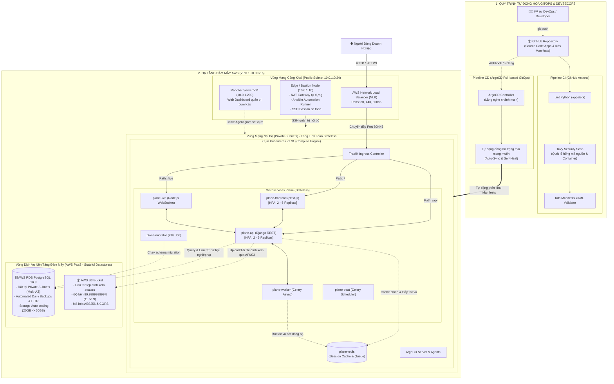
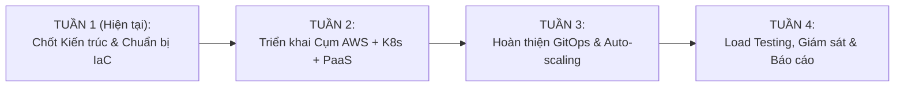

# BÁO CÁO TIẾP THU Ý KIẾN CHỈ ĐẠO & KẾ HOẠCH ĐIỀU CHỈNH ĐỒ ÁN CHUYÊN NGÀNH

> **Kính gửi**: Giảng viên hướng dẫn Đồ án Chuyên ngành  
> **Sinh viên thực hiện**: Nguyễn Đức Thịnh  
> **Tên đề tài điều chỉnh**: Thiết kế và Triển khai Nền tảng Cloud-Native & GitOps Vận hành Hệ thống Quản trị Dự án Doanh nghiệp Phân tán (Plane) trên AWS và Kubernetes  
> **Thời gian báo cáo**: Tuần báo cáo tiến độ (Hạn chốt phương án kiến trúc)  

---

## LỜI MỞ ĐẦU & TIẾP THU Ý KIẾN

Sau buổi báo cáo tiến độ vừa qua, em xin chân thành cảm ơn Thầy đã chỉ rõ những điểm yếu cốt lõi trong cách tiếp cận trước đây của em. Những nhận xét của Thầy về việc **chọn sai mã nguồn cũ**, **thiếu bài toán trọng tâm**, **dùng Cloud sai tư duy (coi Cloud như máy ảo và nhét Database vào Kubernetes)**, cũng như **sơ đồ kiến trúc bị rời rạc** đã giúp em định hình lại hoàn toàn phương pháp luận chuẩn mực của một kỹ sư DevOps / Cloud Solutions Architect.

Trong tuần qua, em đã nghiêm túc tiếp thu, hủy bỏ toàn bộ mã nguồn cũ và hoàn thành việc quy hoạch lại toàn bộ kiến trúc đồ án theo đúng 4 chỉ đạo khắc phục của Thầy. Bản báo cáo này trình bày chi tiết phương án điều chỉnh để kính trình Thầy xem xét và phê duyệt.

*(Về vấn đề thiết bị họp: Em đã đổi sang micro mới và chuẩn bị sẵn ứng dụng thoại trên điện thoại để đảm bảo âm thanh rõ ràng, nghiêm túc trong tất cả các buổi báo cáo tiếp theo).*

---

## PHẦN 1: BẢNG ĐỐI CHIẾU TIẾP THU & KHẮC PHỤC CÁC ĐIỂM YẾU

| STT | Phê bình & Nhắc nhở của Giảng viên | Phương án & Kết quả khắc phục của Sinh viên |
| :---: | :--- | :--- |
| **1** | **Mã nguồn cũ (archive 5–8 năm), rủi ro bảo mật cao** | **Đã chuyển sang Plane (`makeplane/plane`)**: Nền tảng quản lý dự án nguồn mở hiện đại hàng đầu thế giới (hơn 33.000 stars trên GitHub), công nghệ cập nhật hàng ngày (Next.js 14, Django REST Framework, Celery, Node.js). Quét mã sạch và không còn lỗi thời. |
| **2** | **Định hướng mông lung, thiếu bài toán trọng tâm** | **Xác định bài toán thực tế rõ ràng**: Xây dựng nền tảng tự lưu trữ (self-hosted) hệ thống quản trị công việc doanh nghiệp, tập trung giải quyết 3 bài toán kỹ thuật cốt lõi: **Khả năng chịu lỗi & sẵn sàng cao (High Availability)**, **Tách biệt dữ liệu (Decoupled Storage)**, và **Tự động hóa triển khai an toàn theo chuẩn GitOps**. |
| **3** | **Dùng Cloud sai tư duy (Nhét cả Database vào K8s)** | **Phân tách triệt để Stateless Compute và Cloud PaaS**: Giải phóng cụm K8s chỉ chạy các Pod tính toán không lưu trạng thái (Web, API, Worker) có thể tự do co giãn (HPA). Toàn bộ dữ liệu nghiệp vụ quan trọng được đưa ra các dịch vụ chuyên dụng của AWS: **AWS RDS PostgreSQL** (Multi-AZ, sao lưu tự động PITR) và **AWS S3** (lưu trữ tệp đính kèm bền vững 11 số 9). |
| **4** | **Kiến trúc xé lẻ, thiếu liên kết tổng thể** | **Quy hoạch MỘT sơ đồ Master Architecture duy nhất**: Bản vẽ tích hợp liền mạch từ mã nguồn $\to$ CI/CD GitOps (GitHub Actions + ArgoCD) $\to$ Hạ tầng VPC AWS $\to$ Cụm K8s $\to$ Tầng dữ liệu AWS RDS & S3. |

---

## PHẦN 2: MỔ XẺ KIẾN TRÚC MÃ NGUỒN MỚI (PLANE)

Plane được xây dựng theo kiến trúc vi dịch vụ phân tán, cho phép bóc tách triệt để giữa tầng tính toán và tầng lưu trữ:

### 2.1. Tầng Tính toán Phi trạng thái (Stateless Compute - Vận hành trong Kubernetes)
Toàn bộ các thành phần này được đóng gói thành container và chạy trên cụm Kubernetes, có khả năng tự phục hồi (Self-healing) và tự động co giãn theo tải (HPA):
* **`plane-frontend` (Port 3000)**: Giao diện người dùng Web xây dựng trên React / Next.js, kết xuất giao diện bảng Kanban, Roadmap, Sprint.
* **`plane-api` (Port 8000)**: Backend xử lý logic nghiệp vụ chính (Authentication, Permissions, Workspaces, Projects, Issues) bằng Django REST Framework.
* **`plane-live` (Port 3000)**: Dịch vụ WebSocket xây dựng bằng Node.js, duy trì kết nối thời gian thực phục vụ tính năng cộng tác đa người dùng đồng thời.
* **`plane-worker`**: Celery Worker chạy ngầm xử lý các tác vụ tốn tài nguyên như gửi email thông báo, kích hoạt webhook, đồng bộ dữ liệu.
* **`plane-beat`**: Celery Scheduler điều phối các tác vụ định kỳ trong hệ thống.
* **`plane-migrator`**: Kubernetes Job tự động chạy database migrations lên AWS RDS mỗi khi có phiên bản cập nhật trước khi các pod API khởi động.
* **`plane-redis`**: Đóng vai trò bộ nhớ đệm (Session Cache) và hàng đợi thông điệp (Celery Message Broker) trong nội bộ cụm.

### 2.2. Tầng Dữ liệu Có trạng thái (Stateful Datastores - Sử dụng Dịch vụ Nền tảng AWS PaaS)
Nhóm không chạy database bên trong K8s mà ủy thác hoàn toàn cho hạ tầng của nhà cung cấp Cloud:
* **Cơ sở dữ liệu quan hệ (AWS RDS PostgreSQL 16.3)**:
  * Được đặt an toàn trong Private Subnet trải dài qua 2 Availability Zones (`us-east-1a` và `us-east-1b`).
  * Tận dụng cơ chế **Automated Daily Backups** và **Point-in-Time Recovery (PITR)** để phục hồi dữ liệu về bất kỳ thời điểm nào trong quá khứ mà không tốn tài nguyên máy chủ.
  * Bật tính năng **Storage Auto-scaling** (khởi tạo 20 GB, tự động nâng lên đến 50 GB khi đầy).
* **Lưu trữ đối tượng (AWS S3 Bucket)**:
  * Lưu trữ toàn bộ hình ảnh đại diện (avatars), tệp tài liệu đính kèm của dự án, và các bản export báo cáo.
  * Đạt độ bền **99.999999999% (11 số 9)**, không chiếm dụng dung lượng ổ cứng của các Worker Nodes.
  * Cấu hình **CORS** và mã hóa phía máy chủ **AES256**, cho phép tải tệp tin an toàn qua Pre-signed URLs.

---

## PHẦN 3: SƠ ĐỒ KIẾN TRÚC TỔNG QUAN DUY NHẤT (MASTER ARCHITECTURE)

Toàn bộ hệ thống được tích hợp chặt chẽ trong một bản vẽ kiến trúc duy nhất:

---

## PHẦN 4: HIỆN THỰC HÓA QUY TRÌNH GITOPS (CI/CD)

Quy trình phát triển và vận hành tuân thủ nguyên tắc **Declarative Infrastructure as Code (Khai báo trạng thái mong muốn)**:

1. **Continuous Integration (CI) với GitHub Actions**:
   * Khi kỹ sư thực hiện `git push` hoặc tạo `Pull Request` vào nhánh `main`:
     * **Bước 1 (Linting)**: Tự động chạy Flake8 kiểm tra cú pháp và chất lượng mã nguồn Python (`apps/api`).
     * **Bước 2 (Security Scan)**: Tích hợp công cụ **Trivy** quét toàn diện lỗ hổng bảo mật của mã nguồn và các thư viện phụ thuộc.
     * **Bước 3 (Manifests Validation)**: Tự động kiểm tra tính hợp lệ về mặt cú pháp YAML của tất cả các file trong thư mục `k8s/`.
2. **Continuous Delivery (CD) với ArgoCD**:
   * Sử dụng mô hình **Pull-based GitOps**: ArgoCD Controller chạy bên trong cụm K8s liên tục so sánh trạng thái thực tế (Live State) với trạng thái khai báo trong Git (Desired State).
   * Khi phát hiện commit mới trên Git, ArgoCD tự động kéo các manifests về và áp dụng xuống cluster (`Auto-Sync`).
   * Nếu có ai đó can thiệp thủ công vào cụm làm sai lệch cấu hình, ArgoCD sẽ tự động ghi đè về đúng trạng thái trên Git (`Self-Healing`).

---

## PHẦN 5: KẾ HOẠCH TRIỂN KHAI 4 TUẦN TỚI (ROADMAP ĐẾN LÚC BẢO VỆ)

Để đảm bảo tiến độ hoàn thành đồ án đúng hạn (còn khoảng 4 tuần), em đã lập lịch trình chi tiết theo từng tuần:

* **Tuần 1 (Hiện tại - Chốt cuối tuần này)**:
  * [x] Thay thế toàn bộ mã nguồn cũ bằng **Plane** (`apps/`).
  * [x] Viết mới mã nguồn **Terraform** bổ sung module **AWS RDS PostgreSQL** và **AWS S3 Bucket** (Đã chạy `terraform validate` thành công 100%).
  * [x] Viết lại toàn bộ bộ manifests **Kubernetes GitOps** cho Plane trong thư mục `k8s/`.
  * [x] Thiết lập workflow GitHub Actions CI và tài liệu kiến trúc.
* **Tuần 2: Triển khai Thực tế trên AWS Cloud**:
  * Chạy Terraform cấp phát hạ tầng thực tế: VPC, EC2, NLB, RDS PostgreSQL, S3.
  * Chạy Ansible cấu hình cụm K8s v1.31, Traefik Ingress và kết nối Rancher Server.
  * Khởi chạy Plane, kết nối thành công với AWS RDS và tải thử nghiệm file đính kèm lên AWS S3.
* **Tuần 3: Tích hợp GitOps Pipeline & Kiểm thử Co giãn Tự động (HPA)**:
  * Kết nối ArgoCD với GitHub Repository để tự động hóa hoàn toàn luồng deploy.
  * Cấu hình và kích hoạt Horizontal Pod Autoscaler (HPA) cho `plane-frontend` và `plane-api`.
  * Thiết lập quét bảo mật container tự động với Trivy.
* **Tuần 4: Đo lường Hiệu năng, Đánh giá Chịu tải & Hoàn thiện Luận văn**:
  * Thực hiện kiểm thử chịu tải (Load Testing với công cụ k6 / Locust) mô phỏng 500 – 1.000 người dùng truy cập đồng thời để chứng minh tính năng Auto-scaling và độ ổn định của RDS.
  * Đo lường tài nguyên với Prometheus & Grafana trên Rancher.
  * Hoàn thiện toàn bộ báo cáo đồ án, slide thuyết trình và video demo hệ thống.

---

## KẾT LUẬN & KIẾN NGHỊ

Thưa Thầy, toàn bộ các yêu cầu Thầy giao cho nhóm:
1. Đổi sang mã nguồn mở hiện đại và bóc tách thành phần (Plane).
2. Vẽ MỘT sơ đồ kiến trúc tổng thể duy nhất tích hợp liền mạch.
3. Làm rõ luồng GitOps CI/CD (GitHub Actions + ArgoCD).
4. Phân bổ đúng tư duy Cloud (Stateless trong K8s, Stateful trên AWS RDS & S3).

đều đã được em hoàn thành và đóng gói hoàn chỉnh trong mã nguồn dự án tại thời điểm cuối tuần này.

Em kính mong Thầy xem xét và phê duyệt phương án kiến trúc điều chỉnh nêu trên để em bắt tay ngay vào giai đoạn triển khai thực tế trên hạ tầng AWS trong tuần tới ạ.

Em xin trân trọng cảm ơn Thầy!

---
*Sinh viên thực hiện:*  
**Nguyễn Đức Thịnh**
