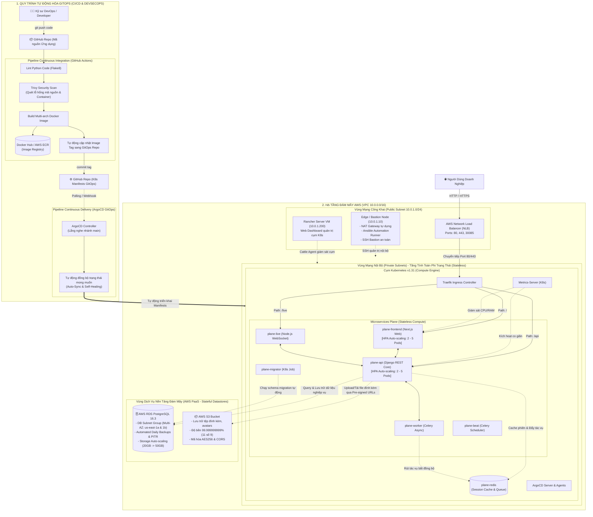
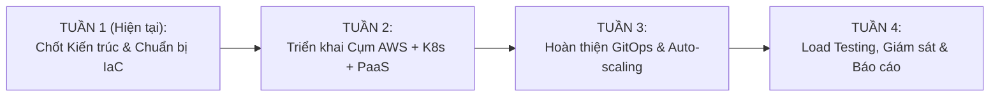

# BẢN THUYẾT MINH KIẾN TRÚC TỔNG THỂ HỆ THỐNG CLOUD-NATIVE & GITOPS

> **Đề tài**: Thiết kế và Triển khai Nền tảng Cloud-Native & GitOps Vận hành Hệ thống Quản trị Dự án Phân tán (Plane) trên Nền tảng AWS và Kubernetes  
> **Sinh viên thực hiện**: Nguyễn Đức Thịnh  
> **Hệ thống ứng dụng demo**: Nền tảng quản trị công việc mã nguồn mở Plane (`makeplane/plane`)  

---

## 1. BÀI TOÁN KỸ THUẬT TRỌNG TÂM (PROBLEM STATEMENT)

### 1.1. Bối cảnh Nghiệp vụ
Trong môi trường doanh nghiệp hiện đại, hệ thống theo dõi tiến độ và quản lý dự án (Project Management & Issue Tracking) là dịch vụ cốt lõi hoạt động 24/7. Việc tự triển khai và vận hành (self-hosted) một hệ thống vi dịch vụ quy mô lớn đòi hỏi hạ tầng phải giải quyết triệt để 3 bài toán kỹ thuật:
1. **Tính sẵn sàng cao (High Availability - HA)**: Đảm bảo hệ thống không có điểm nghẽn đơn lẻ (No Single Point of Failure - SPOF), duy trì dịch vụ liên tục ngay cả khi một máy chủ hoặc tiến trình gặp sự cố.
2. **Khả năng co giãn tự động (Auto-scaling)**: Hệ thống phải tự động tăng giảm số lượng bản sao tính toán (Pods) tương ứng với lưu lượng người dùng thay đổi theo thời gian thực (giờ cao điểm và giờ thấp điểm).
3. **Tách biệt dữ liệu và tính toán (Decoupled Compute & Storage)**: Toàn bộ dữ liệu quan trọng của doanh nghiệp không được lưu phụ thuộc vào vòng đời của các máy chủ tính toán tạm thời (ephemeral nodes), mà phải được bảo vệ bởi các dịch vụ lưu trữ chuyên dụng có độ bền cao và sao lưu tự động.
4. **Tự động hóa triển khai an toàn (GitOps & DevSecOps)**: Loại bỏ hoàn toàn thao tác cấu hình thủ công dễ gây lỗi, tự động kiểm tra chất lượng mã nguồn, quét lỗ hổng bảo mật container trước khi phát hành, và đồng bộ cấu hình tự động.

---

## 2. BÓC TÁCH KIẾN TRÚC MÃ NGUỒN PLANE (`makeplane/plane`)

Plane là nền tảng quản trị dự án mã nguồn mở hiện đại hàng đầu (hơn 33.000 stars trên GitHub), được phát triển theo mô hình vi dịch vụ phân tán. Việc phân tích bóc tách các thành phần nền tảng của Plane được xác định như sau:

| Thành phần của Plane | Công nghệ nền tảng | Phân bổ tài nguyên | Vai trò kỹ thuật & Chức năng |
| :--- | :--- | :--- | :--- |
| **`plane-frontend`** | Next.js / React Router | **Kubernetes (Stateless)** | Giao diện người dùng Web, tối ưu SEO và Client-side rendering. Có thể co giãn độc lập (HPA). |
| **`plane-api`** | Django REST Framework (Python) | **Kubernetes (Stateless)** | Xử lý toàn bộ logic nghiệp vụ (xác thực, phân quyền, CRUD dự án, task, issue). Có thể co giãn độc lập (HPA). |
| **`plane-live`** | Node.js / Socket.IO | **Kubernetes (Stateless)** | Kết nối WebSocket thời gian thực, phục vụ tính năng cộng tác đa người dùng đồng thời trên bảng Kanban. |
| **`plane-worker`** | Celery Worker (Python) | **Kubernetes (Stateless)** | Tiến trình xử lý tác vụ ngầm bất đồng bộ: gửi email thông báo, kích hoạt webhook, xử lý tệp nặng. |
| **`plane-beat`** | Celery Beat (Python) | **Kubernetes (Stateless)** | Bộ điều phối lịch trình, kích hoạt các tác vụ định kỳ trong hệ thống. |
| **`plane-migrator`** | Django DB Migrations | **Kubernetes (K8s Job)** | Tiến trình tự động kiểm tra và nâng cấp schema cơ sở dữ liệu trên RDS trước khi API tiếp nhận traffic. |
| **`plane-redis`** | Redis In-memory | **Kubernetes (Stateless)** | Lưu phiên đăng nhập (Session Cache) và hàng đợi thông điệp (Celery Message Broker). |
| **Cơ sở dữ liệu** | PostgreSQL 16.3 | **AWS RDS (Stateful PaaS)** | Lưu trữ dữ liệu quan hệ cốt lõi (Users, Workspaces, Projects, Issues). Tận dụng Multi-AZ và Automated Backups. |
| **Lưu trữ tệp tin** | Object Storage API | **AWS S3 (Stateful PaaS)** | Lưu trữ hình ảnh đại diện, file đính kèm công việc, bản xuất báo cáo với độ bền 99.999999999% (11 số 9). |

---

## 3. SƠ ĐỒ KIẾN TRÚC TỔNG THỂ DUY NHẤT (MASTER ARCHITECTURE)

Sơ đồ quy hoạch toàn bộ các thành phần công cụ, dịch vụ đám mây và luồng liên kết trong một bản vẽ duy nhất:



---

## 4. PHÂN BỔ TÀI NGUYÊN VÀ THUYẾT MINH KIẾN TRÚC CLOUD-NATIVE

Hệ thống được thiết kế theo đúng nguyên tắc chuẩn mực của Cloud-Native: **Tách biệt Tầng Tính toán Phi trạng thái và Tầng Dữ liệu Có trạng thái**.

### 4.1. Tầng Tính toán Phi trạng thái (Stateless Compute - Kubernetes)
* **Toàn bộ microservices của Plane** (`frontend`, `api`, `live`, `worker`, `beat`, `migrator`) được đóng gói thành container và triển khai trên các Worker Nodes đặt trong **Private Subnet**.
* **Đặc tính Phi trạng thái**: Các Pod không lưu dữ liệu vĩnh viễn vào ổ cứng cục bộ. Nếu một Worker Node hoặc Pod bị lỗi, hệ thống tự động khởi tạo Pod thay thế mà không gây mất mát dữ liệu (Self-healing).
* **Định tuyến Layer 7 (Traefik Ingress)**:
  * Phân phối lưu lượng thông minh dựa trên URI path: `/` đưa về `plane-frontend`, `/api` đưa về `plane-api`, `/live` đưa về WebSocket `plane-live`.

### 4.2. Tầng Dữ liệu Có trạng thái (Stateful Datastores - AWS Cloud PaaS)
Nhóm không tự dựng database container trong Kubernetes mà sử dụng các dịch vụ nền tảng tích hợp sẵn của AWS:
* **Cơ sở dữ liệu quan hệ (AWS RDS PostgreSQL 16.3)**:
  * Nằm trong **DB Subnet Group** trải dài qua 2 Availability Zones (`us-east-1a` và `us-east-1b`), được bảo vệ bởi Security Group chỉ mở cổng 5432 cho các Worker Nodes.
  * **Automated Backups & Point-in-Time Recovery (PITR)**: Sao lưu tự động liên tục, hỗ trợ phục hồi dữ liệu về từng giây chính xác khi có sự cố.
  * **Storage Auto-scaling**: Khởi tạo 20 GB gp3 và tự động mở rộng lên tới 50 GB mà không gây downtime.
* **Lưu trữ đối tượng (AWS S3 Bucket)**:
  * Lưu trữ bền vững tài liệu đính kèm với độ bền **99.999999999% (11 số 9)**, không làm tiêu tốn dung lượng đĩa cứng của các Node K8s.
  * Cấu hình **CORS** và mã hóa phía máy chủ **AES256**, cho phép tải tệp tin an toàn qua Pre-signed URLs.

### 4.3. Cơ chế Khả năng Sẵn Sàng Cao (HA), Cân Bằng Tải & Co Giãn Tự Động (HPA)
* **Cân bằng tải nhiều lớp**:
  * *Lớp ngoài cùng (Layer 4)*: **AWS Network Load Balancer (NLB)** phân phối lưu lượng vào các node worker với độ trễ siêu thấp.
  * *Lớp ứng dụng (Layer 7)*: **Traefik Ingress Controller** cân bằng tải giữa các Pod backend.
* **Co giãn Pod tự động (Horizontal Pod Autoscaler - HPA)**:
  * Thu thập chỉ số tài nguyên qua `metrics-server`.
  * Cấu hình HPA tự động tăng từ **2 lên tối đa 5 bản sao (Pods)** cho cả `plane-frontend` và `plane-api` khi mức sử dụng CPU vượt quá 70%–75% hoặc RAM vượt quá 80%. Khi tải giảm, HPA tự động thu hồi số lượng Pod về mức cơ bản để tối ưu chi phí.

---

## 5. QUY TRÌNH GITOPS KHÉP KÍN (CI/CD)

Quy trình phát triển và vận hành hệ thống được tự động hóa 100% theo mô hình **Declarative GitOps**:

```
[ Developer ] 
      │ (git push)
      ▼
[ GitHub Repository ] ──> (Trigger) ──> [ Pipeline CI: GitHub Actions ]
                                                │
                                                ├── 1. Lint Code (Flake8)
                                                ├── 2. Quét bảo mật (Trivy Scan)
                                                ├── 3. Kiểm tra YAML (K8s Manifests)
                                                ├── 4. Build Multi-arch Container
                                                └── 5. Push Image Registry (Docker Hub)
                                                            │
                                                            ▼ (Update Image Tag)
[ GitOps Manifests Repo ] <─────────────────────────────────┘
      │
      ▼ (Pull-based Sync)
[ ArgoCD Controller (in K8s) ]
      │
      ▼ (Apply Desired State)
[ Kubernetes Cluster (Plane Pods) ] (Zero Downtime Rolling Update)
```

1. **Continuous Integration (CI - GitHub Actions)**:
   * **Kiểm tra chất lượng mã (Linting)**: Tự động chạy Flake8 kiểm tra cú pháp và chất lượng mã nguồn Python (`apps/api`).
   * **Quét bảo mật tĩnh & Container (Trivy Scan)**: Rà quét lỗ hổng bảo mật (CVEs) trong mã nguồn và thư viện phụ thuộc trước khi đóng gói.
   * **Kiểm thử cú pháp Manifests**: Tự động xác thực tính hợp lệ của toàn bộ file YAML trong thư mục `k8s/`.
   * **Đóng gói & Phát hành**: Tự động build Docker Image và đẩy lên Image Registry (Docker Hub), sau đó cập nhật tag phiên bản mới vào kho GitOps.
2. **Continuous Delivery (CD - ArgoCD Pull-based GitOps)**:
   * ArgoCD Controller chạy thường trực trong cluster, định kỳ lắng nghe kho lưu trữ Git.
   * Khi phát hiện thay đổi trên Git, ArgoCD tự động kéo cấu hình về và áp dụng xuống cụm (`Auto-Sync`).
   * Bật cơ chế **Self-Healing**: Mọi thay đổi thủ công không thông qua Git trên cụm K8s đều bị ArgoCD tự động ghi đè về đúng trạng thái mong muốn (Desired State) đã khai báo.

---

## 6. KẾ HOẠCH TRIỂN KHAI 4 TUẦN (ROADMAP HOÀN THÀNH ĐỒ ÁN)

Lộ trình chi tiết phân bổ cho 4 tuần còn lại để đảm bảo tiến độ bảo vệ:



* **Tuần 1 (Hiện tại - Chốt cuối tuần này)**:
  * [x] Chốt mã nguồn mở **Plane** (`apps/`).
  * [x] Bóc tách thành phần nền tảng và vẽ sơ đồ Master Architecture duy nhất.
  * [x] Viết mới mã nguồn **Terraform** bổ sung module **AWS RDS PostgreSQL** và **AWS S3 Bucket** (Đã chạy `terraform validate` thành công 100%).
  * [x] Hoàn thiện bộ manifests **Kubernetes GitOps** cho Plane trong thư mục `k8s/` và workflow GitHub Actions CI.
* **Tuần 2: Triển khai Cụm Thực tế trên AWS Cloud**:
  * Chạy `terraform apply` cấp phát toàn bộ VPC, EC2 K8s Nodes, NLB, RDS PostgreSQL và S3 Bucket.
  * Chạy Ansible playbook cài đặt K8s v1.31, Traefik Ingress và kết nối Rancher Server Dashboard.
  * Khởi chạy Plane, kết nối thành công với AWS RDS Postgres và tải thử nghiệm file đính kèm lên AWS S3.
* **Tuần 3: Thiết lập Pipeline GitOps & Tự động Co giãn (HPA)**:
  * Kết nối ArgoCD với Git repo, kiểm thử luồng cập nhật ứng dụng tự động khi có commit mới.
  * Cấu hình và kích hoạt Horizontal Pod Autoscaler (HPA) cho `plane-frontend` và `plane-api`.
  * Tích hợp Trivy quét lỗ hổng container tự động trong CI pipeline.
* **Tuần 4: Đo lường Hiệu năng, Đánh giá Chịu tải & Hoàn thiện Luận văn**:
  * Thực hiện kiểm thử chịu tải (Load Testing với công cụ k6 / Locust) mô phỏng 500 – 1.000 người dùng truy cập đồng thời để chứng minh tính năng Auto-scaling của K8s và độ ổn định của AWS RDS.
  * Thu thập số liệu tài nguyên qua Prometheus & Grafana trên Rancher.
  * Hoàn thiện toàn bộ báo cáo đồ án, slide thuyết trình và video demo hệ thống phục vụ buổi bảo vệ chính thức.
