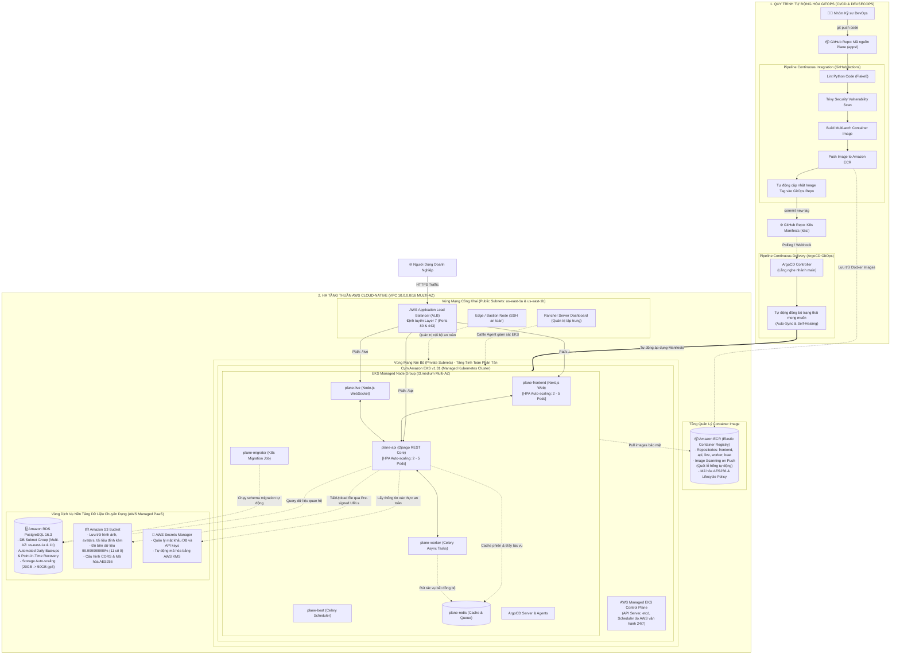

# BẢN THUYẾT MINH KIẾN TRÚC TỔNG THỂ HỆ THỐNG THUẦN CLOUD-NATIVE & GITOPS

> **Học phần**: NT114.R11 - Đồ án chuyên ngành (Học kỳ 1, Năm học 2026 - 2027)  
> **Tên đề tài chính thức**: Nghiên cứu và xây dựng nền tảng vận hành ứng dụng microservices trên Kubernetes *(Building a Platform for Deploying and Operating Microservices on Kubernetes)*  
> **Giảng viên hướng dẫn**: ThS. Văn Thiên Luân  
> **Sinh viên thực hiện**:  
> 1. **Đào Đức Thịnh** - MSSV: 23521495 *(Chủ nhiệm đề tài)*  
> 2. **Nguyễn Bá Thiện** - MSSV: 23521480  
> **Hệ thống ứng dụng demo**: Nền tảng quản trị công việc vi dịch vụ mã nguồn mở Plane (`makeplane/plane`)  
> **Định hướng kiến trúc**: **Tối đa hóa việc sử dụng các dịch vụ nền tảng tích hợp sẵn (100% Fully Managed Native Cloud Stack) của Amazon Web Services (AWS)**  

---

## 1. BÀI TOÁN KỸ THUẬT TRỌNG TÂM (PROBLEM STATEMENT)

Hệ thống tập trung giải quyết bài toán vận hành nền tảng quản trị dự án doanh nghiệp quy mô lớn trên nền tảng điện toán đám mây AWS với 4 mục tiêu cốt lõi:
1. **Tận dụng tối đa Dịch vụ Nền tảng Đám mây (Native Cloud Services)**: Thay vì sử dụng Cloud như các máy ảo đơn thuần (IaaS) và tự cài đặt thủ công, đồ án chuyển dịch toàn diện sang các dịch vụ do chính nhà cung cấp Cloud quản lý tự động (**Amazon EKS, Amazon ECR, Amazon RDS, Amazon S3, AWS Secrets Manager**).
2. **Tính sẵn sàng cao (High Availability) & Khả năng chịu lỗi**: Kiến trúc đa vùng khả dụng (**Multi-AZ Architecture**) trải dài qua `us-east-1a` và `us-east-1b`, loại bỏ hoàn toàn các điểm nghẽn đơn lẻ (No Single Point of Failure).
3. **Phân tách triệt để Stateless Compute và Stateful Datastores**: Tầng tính toán vi dịch vụ trên Kubernetes hoàn toàn không lưu trạng thái (ephemeral), toàn bộ dữ liệu quan trọng được bảo vệ độc lập bởi các dịch vụ dữ liệu chuyên dụng có độ bền 11 số 9 và tự động sao lưu Point-in-Time.
4. **Tự động hóa toàn diện bằng GitOps & DevSecOps**: Hạ tầng được định nghĩa 100% dưới dạng mã (**Terraform**), quy trình kiểm thử bảo mật tự động (**Trivy**) và triển khai liên tục không gián đoạn dịch vụ (**ArgoCD**).

---

## 2. BÓC TÁCH KIẾN TRÚC MÃ NGUỒN PLANE VỚI HỆ SINH THÁI AWS NATIVE

Ứng dụng thực nghiệm **Plane (`makeplane/plane`)** (hơn 33.000 stars trên GitHub) được quy hoạch bóc tách tương thích hoàn toàn với các dịch vụ chuyên dụng của AWS:

| Thành phần của Plane | Công nghệ nền tảng | Dịch vụ AWS Native đảm nhiệm | Lợi thế kỹ thuật vượt trội |
| :--- | :--- | :--- | :--- |
| **`plane-frontend`** | Next.js / React Router | **Amazon EKS (Stateless Pods)** | Tự động nhân bản co giãn từ 2 đến 5 Pods bằng HPA theo lưu lượng truy cập thực tế. |
| **`plane-api`** | Django REST (Python) | **Amazon EKS (Stateless Pods)** | Xử lý logic nghiệp vụ, kết nối bảo mật tới RDS qua Private Subnet. |
| **`plane-live`** | Node.js / Socket.IO | **Amazon EKS (Stateless Pods)** | Duy trì kết nối WebSocket thời gian thực cho tính năng cộng tác Kanban. |
| **`plane-worker` & `beat`** | Celery Worker & Scheduler | **Amazon EKS (Stateless Pods)** | Xử lý tác vụ bất đồng bộ (email, webhook, export dữ liệu) rút từ hàng đợi Redis. |
| **`plane-migrator`** | Django DB Migrations | **Amazon EKS (K8s Job)** | Tự động nâng cấp schema database trên RDS trước khi API khởi động. |
| **Container Images** | Docker Multi-arch | **Amazon ECR (Elastic Container Registry)** | Quét lỗ hổng tự động khi push (`scan_on_push`), mã hóa AES256, vòng đời tự xóa ảnh cũ. |
| **Cơ sở dữ liệu quan hệ** | PostgreSQL 16.3 Engine | **Amazon RDS PostgreSQL** | Đặt trong Private DB Subnet Group (Multi-AZ), Automated Daily Backups PITR, Storage Auto-scaling 20GB $\to$ 50GB. |
| **Lưu trữ tệp tin & Media** | Object Storage API | **Amazon S3 Bucket** | Lưu trữ avatar, file đính kèm với độ bền 99.999999999% (11 số 9), tích hợp CORS và Pre-signed URLs. |
| **Bảo mật & Credentials** | API Keys & DB Passwords | **AWS Secrets Manager** | Quản lý mật khẩu tập trung, mã hóa bằng AWS KMS, không lưu mật khẩu tĩnh trong mã nguồn. |
| **Cân bằng tải & Ingress** | HTTP/HTTPS Traffic | **AWS Application Load Balancer (ALB)** | Cân bằng tải Layer 7 thông minh, định tuyến URL path (`/`, `/api`, `/live`), tích hợp SSL/TLS. |

---

## 3. SƠ ĐỒ KIẾN TRÚC TỔNG THỂ DUY NHẤT (MASTER ARCHITECTURE)

Sơ đồ thể hiện luồng tích hợp liền mạch giữa **Quy trình GitOps (CI/CD)**, **Hệ sinh thái Thuần AWS Cloud-Native** và **Tầng Vi Dịch Vụ Plane**:

---

## 4. THUYẾT MINH PHÂN BỔ TÀI NGUYÊN & ƯU THẾ CỦA HỆ SINH THÁI AWS NATIVE

Kiến trúc mới giải quyết triệt để vấn đề "dùng Cloud sai tư duy" bằng cách chuyển dịch 100% sang mô hình **Managed Services**:

### 4.1. Tầng Tính Toán Điều Phối Container: Amazon EKS
* **Thay vì tự dựng K8s thủ công trên EC2**: Nhóm sử dụng **Amazon EKS v1.31** — dịch vụ Kubernetes do AWS trực tiếp điều hành và bảo trì tầng Control Plane (`kube-apiserver`, `etcd`, `controller-manager`).
* **Lợi thế kỹ thuật**:
  * Đạt chuẩn **SLA sẵn sàng 99.95%** từ AWS, tự động chuyển đổi dự phòng khi một master node gặp sự cố mà sinh viên không cần can thiệp.
  * Tích hợp **EKS Managed Node Groups** tự động quản lý vòng đời máy ảo Worker Nodes, tự động thay thế instance mới nếu phát hiện lỗi phần cứng (Self-healing ở tầng hạ tầng).

### 4.2. Tầng Quản Lý Bản Đóng Gói: Amazon ECR
* **Thay vì đẩy image lên Docker Hub cá nhân bên ngoài**: Nhóm sử dụng **Amazon ECR** nội bộ trong cùng AWS Region.
* **Lợi thế kỹ thuật**:
  * Tốc độ kéo (pull) image về cụm EKS nhanh gấp 5 lần qua đường truyền nội mạng AWS Private Network.
  * Kích hoạt cơ chế **Image Scanning on Push**: Mỗi khi GitHub Actions đẩy image mới lên, ECR tự động quét và cảnh báo các lỗ hổng phần mềm trước khi cho phép triển khai.

### 4.3. Tầng Dữ Liệu Có Trạng Thái: Amazon RDS & Amazon S3
* **Cơ sở dữ liệu Amazon RDS PostgreSQL 16.3**:
  * Nằm trong **DB Subnet Group** trải dài qua 2 Availability Zones (`us-east-1a` và `us-east-1b`), được bảo vệ trong Private Subnet chỉ cho phép kết nối từ EKS Security Group qua cổng 5432.
  * **Automated Daily Backups & Point-in-Time Recovery (PITR)**: Sao lưu liên tục từng giây, bảo vệ dữ liệu nghiệp vụ tuyệt đối an toàn.
  * **Storage Auto-scaling**: Tự động mở rộng từ 20 GB lên 50 GB khi lượng task/dự án tăng trưởng.
* **Lưu trữ đối tượng Amazon S3**:
  * Lưu trữ bền vững tài liệu, avatar với độ bền **99.999999999% (11 số 9)**.
  * Không làm tiêu hao ổ cứng máy ảo K8s, cho phép phân phối file trực tiếp qua Pre-signed URLs và hỗ trợ CORS đầy đủ cho frontend.

### 4.4. Tầng Bảo Mật & Quản Lý Bí Mật: AWS Secrets Manager
* Mật khẩu quản trị database và các khóa mã hóa Django Session không bị hard-code trong file cấu hình hay Git.
* Tất cả được lưu trữ tại **AWS Secrets Manager**, tự động mã hóa bằng **AWS KMS (Key Management Service)** và được cấp phát cho Pod khi khởi động.

### 4.5. Cơ chế Cân Bằng Tải & Co Giãn Tự Động (Auto-scaling)
* **Cân bằng tải Layer 7 thông minh**: **AWS Application Load Balancer (ALB)** tiếp nhận lưu lượng từ người dùng và tự động định tuyến đến các nhóm Pod tương ứng theo URL path (`/`, `/api`, `/live`).
* **Co giãn Pod tự động (Horizontal Pod Autoscaler - HPA)**:
  * Thu thập dữ liệu tài nguyên thông qua `metrics-server`.
  * Tự động điều chỉnh số lượng bản sao từ **2 đến 5 Pods** cho cả `plane-frontend` và `plane-api` khi mức tiêu thụ CPU vượt 70% hoặc RAM vượt 80%, đảm bảo hệ thống phản ứng tức thì khi có đột biến truy cập.

---

## 5. QUY TRÌNH GITOPS KHÉP KÍN (CI/CD)

Hệ thống vận hành theo chu trình tự động hóa khép kín:

$$\text{Developer} \xrightarrow{\text{git push}} \text{GitHub Actions CI} \xrightarrow{\text{Lint + Trivy}} \text{Push Amazon ECR} \xrightarrow{\text{Update Tag}} \text{ArgoCD (in EKS)} \xrightarrow{\text{Pull-based Sync}} \text{EKS Pods (Zero Downtime)}$$

1. **Continuous Integration (CI) với GitHub Actions**:
   * Khi có commit vào nhánh `main`, pipeline tự động chạy kiểm tra chất lượng mã nguồn Python (`apps/api`), kích hoạt công cụ **Trivy** quét mã độc, đóng gói Docker Image và đẩy trực tiếp lên **Amazon ECR**.
   * Sau khi push thành công, GitHub Actions tự động cập nhật Image Tag mới vào thư mục manifests `k8s/` của kho GitOps.
2. **Continuous Delivery (CD) với ArgoCD**:
   * ArgoCD Controller thường trực trong cụm EKS tự động phát hiện thay đổi trên GitOps repo.
   * Tiến hành kéo cấu hình về và áp dụng xuống cụm (`Auto-Sync`) theo chiến lược **Rolling Update** (không gián đoạn dịch vụ).
   * Kích hoạt cơ chế **Self-Healing**: Mọi hành vi sửa đổi thủ công trên cụm đều tự động bị ghi đè về đúng trạng thái khai báo trong Git.

---

## 6. KẾ HOẠCH TRIỂN KHAI 4 TUẦN (ROADMAP HOÀN THÀNH ĐỒ ÁN)

Lịch trình chi tiết đảm bảo hoàn thành đồ án đúng hạn bảo vệ:

* **Tuần 1 (Hiện tại - Chốt cuối tuần này)**:
  * [x] Quy hoạch lại 100% hệ thống sang hệ sinh thái **AWS Native Services** (EKS, ECR, RDS, S3, Secrets Manager).
  * [x] Bóc tách kiến trúc mã nguồn mở **Plane** và hoàn thiện sơ đồ Master Architecture duy nhất.
  * [x] Viết và kiểm thử thành công mã nguồn **Terraform** (`terraform plan: 78 to add, 0 to destroy` trên nhánh `feature/aws-eks`).
  * [x] Hoàn thiện tài liệu kỹ thuật báo cáo Giảng viên hướng dẫn.
* **Tuần 2: Cấp Phát Thực Tế Cụm AWS Native Infrastructure**:
  * Chạy `terraform apply` khởi tạo thực tế: Amazon EKS Cluster, EKS Managed Node Group, Amazon ECR, Amazon RDS PostgreSQL, Amazon S3, AWS Secrets Manager.
  * Cấu hình `kubectl` kết nối tới EKS, triển khai thử nghiệm Plane và kiểm tra lưu trữ dữ liệu lên RDS & S3.
* **Tuần 3: Tích Hợp Toàn Diện Pipeline GitOps & Tự Động Co Giãn (HPA)**:
  * Kết nối ArgoCD vào cụm EKS, tự động hóa luồng đồng bộ từ GitHub Repository.
  * Cấu hình và kiểm thử tính năng tự động co giãn Horizontal Pod Autoscaler (HPA) khi giả lập tăng tải.
  * Thiết lập quét bảo mật container tự động với Trivy trong CI pipeline.
* **Tuần 4: Đo Lường Hiệu Năng, Kiểm Thử Chịu Tải (Load Test) & Báo Cáo Luận Văn**:
  * Thực hiện kiểm thử chịu tải bằng công cụ **k6 / Locust** mô phỏng 500 – 1.000 người dùng truy cập đồng thời để đánh giá hiệu quả của HPA và tính ổn định của cụm EKS + RDS.
  * Hoàn thiện toàn bộ báo cáo tốt nghiệp, slide thuyết trình và video demo hệ thống phục vụ hội đồng bảo vệ.
