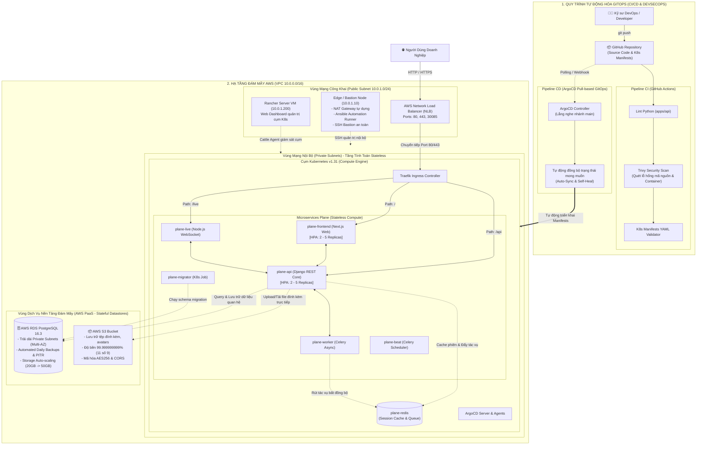

# TÀI LIỆU KIẾN TRÚC TỔNG THỂ HỆ THỐNG CLOUD-NATIVE & GITOPS

> **Đề tài**: Thiết kế và Triển khai Nền tảng Cloud-Native & GitOps Vận hành Hệ thống Quản trị Dự án Phân tán (Plane) trên Nền tảng AWS và Kubernetes  
> **Sinh viên thực hiện**: Nguyễn Đức Thịnh  

---

## 1. SƠ ĐỒ KIẾN TRÚC TỔNG THỂ DUY NHẤT (MASTER ARCHITECTURE)

Sơ đồ thể hiện bức tranh toàn cảnh tích hợp liền mạch giữa **Quy trình Tự động hóa GitOps (CI/CD)**, **Hạ tầng Mạng Đám mây AWS**, **Tầng Tính toán Phi trạng thái (Kubernetes)** và **Tầng Dữ liệu Có trạng thái (AWS Native PaaS)**:

---

## 2. THUYẾT MINH MÔ TẢ CHI TIẾT SƠ ĐỒ KIẾN TRÚC

Kiến trúc hệ thống được phân lớp rõ ràng thành **4 khối chức năng chính**, vận hành đồng bộ và bổ trợ lẫn nhau:

### 2.1. Khối 1: Quy trình Tự động hóa GitOps & DevSecOps (CI/CD)
* **Mã nguồn tập trung (Single Source of Truth)**: Toàn bộ mã nguồn ứng dụng (`apps/`) và các khai báo trạng thái mong muốn của hạ tầng Kubernetes (`k8s/`) được quản lý tập trung trên GitHub Repository.
* **Continuous Integration (CI) - GitHub Actions**:
  1. *Linting*: Tự động phân tích chất lượng cú pháp mã nguồn Python của core backend (`apps/api`) nhằm ngăn ngừa lỗi logic trước khi đóng gói.
  2. *Security Scanning*: Tích hợp công cụ **Trivy** tự động quét mã nguồn và dependencies để phát hiện các lỗ hổng bảo mật (CVEs) theo chuẩn DevSecOps.
  3. *Manifests Validation*: Kiểm tra cú pháp YAML của toàn bộ Kubernetes manifests để đảm bảo không có sai sót cấu hình trước khi triển khai.
* **Continuous Delivery (CD) - ArgoCD (Pull-based GitOps)**:
  * ArgoCD Controller chạy thường trực bên trong cụm Kubernetes, liên tục giám sát nhánh `main` của repository.
  * Khi có commit mới được phê duyệt, ArgoCD tự động kéo các manifests về và áp dụng xuống cụm (`Auto-Sync`).
  * Cơ chế `Self-Healing`: Nếu phát hiện bất kỳ sự thay đổi cấu hình thủ công nào làm sai lệch trạng thái trên cluster, ArgoCD sẽ tự động điều chỉnh đưa hệ thống về đúng trạng thái khai báo trong Git.

---

### 2.2. Khối 2: Hạ tầng Mạng & Vùng Truy Cập Công Khai (Public Zone - AWS Cloud)
Toàn bộ hệ thống đặt trong một mạng ảo độc lập **AWS VPC (10.0.0.0/16)**:
* **AWS Network Load Balancer (NLB)**:
  * Là điểm tiếp nhận lưu lượng duy nhất từ Internet, phân phối lưu lượng vào các Worker Nodes trên các cổng 80 (HTTP), 443 (HTTPS) và 30085 (Giao diện ArgoCD).
  * Khả năng xử lý hàng triệu request mỗi giây với độ trễ cực thấp (Ultra-low latency).
* **Edge / Bastion Node (10.0.1.10)**:
  * Đóng vai trò làm máy chủ trung gian (SSH Bastion) an toàn để kỹ sư DevOps truy cập vào mạng nội bộ.
  * Tích hợp cơ chế **iptables NAT Gateway tự dựng** cho phép toàn bộ các máy chủ trong Private Subnet có thể tải bản vá, cài đặt gói từ Internet mà không cần phơi lộ địa chỉ IP Public ra ngoài.
* **Rancher Server VM (10.0.1.200)**:
  * Cung cấp Web UI dashboard tập trung để giám sát tài nguyên (CPU, RAM, Pods) và quản lý vòng đời cụm Kubernetes thông qua `cattle-cluster-agent`.

---

### 2.3. Khối 3: Tầng Tính Toán Phi Trạng Thái Trên Kubernetes (Stateless Compute - Private Subnets)
Tất cả các máy chủ K8s (1 Control Plane và 2 Worker Nodes) đều được đặt trong **Private Subnet** nhằm cách ly hoàn toàn khỏi các cuộc tấn công trực diện từ Internet:
* **Traefik Ingress Controller**:
  * Tiếp nhận lưu lượng từ NLB và thực hiện định tuyến Layer 7 dựa trên đường dẫn (Path-based Routing):
    * Đường dẫn `/` $\to$ Chuyển tiếp tới giao diện Web Next.js (`plane-frontend`).
    * Đường dẫn `/api` $\to$ Chuyển tiếp tới core API Django (`plane-api`).
    * Đường dẫn `/live` $\to$ Chuyển tiếp WebSocket tới dịch vụ cộng tác (`plane-live`).
* **Các Vi dịch vụ Stateless của Plane**:
  * `plane-frontend`: Chạy giao diện React/Next.js phục vụ người dùng.
  * `plane-api`: Xử lý toàn bộ logic dự án, phân quyền, workflow trạng thái công việc.
  * `plane-live`: Duy trì kết nối WebSocket thời gian thực giữa các thành viên đang cùng chỉnh sửa bảng Kanban.
  * `plane-worker` & `plane-beat`: Xử lý tác vụ ngầm (gửi email, webhook) và điều phối công việc định kỳ qua hàng đợi Celery.
  * `plane-migrator`: K8s Job tự động chạy migrate cơ sở dữ liệu lên AWS RDS trước khi API bắt đầu nhận traffic.
  * `plane-redis`: Bộ nhớ đệm in-memory phục vụ lưu phiên đăng nhập và hàng đợi tác vụ của Celery.
* **Cơ chế Co Giãn Tự Động (Horizontal Pod Autoscaler - HPA)**:
  * Cấu hình HPA cho cả `plane-frontend` và `plane-api` với ngưỡng co giãn từ **2 đến 5 Pods**. Khi tải CPU hoặc Memory vượt ngưỡng 70%–80%, Kubernetes sẽ tự động nhân bản thêm Pod để san sẻ tải; khi tải giảm, hệ thống tự động thu hồi Pod để tiết kiệm tài nguyên.

---

### 2.4. Khối 4: Tầng Dữ Liệu Có Trạng Thái Trên Nền Tảng Đám Mây (Stateful Datastores - AWS PaaS)
Nhóm tách biệt hoàn toàn dữ liệu có trạng thái ra khỏi Kubernetes để tận dụng tối đa năng lực sẵn có của nhà cung cấp Cloud:
* **AWS RDS PostgreSQL 16.3 (Managed Relational Database)**:
  * Nằm trong **DB Subnet Group** trải dài qua 2 Availability Zones (`us-east-1a` và `us-east-1b`), được bảo vệ bởi Security Group riêng chỉ mở cổng `5432` cho K8s Nodes.
  * **Automated Backups & Point-in-Time Recovery (PITR)**: Tự động sao lưu hàng ngày và hỗ trợ phục hồi dữ liệu về từng giây chính xác khi có sự cố.
  * **Storage Auto-scaling**: Dung lượng ổ đĩa khởi tạo 20 GB gp3 và tự động mở rộng lên tới 50 GB mà không gây gián đoạn hoạt động của hệ thống (Zero Downtime).
* **AWS S3 Bucket (Managed Object Storage)**:
  * Lưu trữ bền vững toàn bộ hình ảnh, tài liệu đính kèm và file xuất báo cáo với độ bền dữ liệu **99.999999999% (11 số 9)**.
  * Được thiết lập **CORS Rule** và mã hóa **AES256**, cho phép giao diện Web của Plane tải và hiển thị file đính kèm an toàn qua URL có chữ ký bảo mật (Pre-signed URLs) mà không tốn bất kỳ dung lượng ổ đĩa nào của máy chủ K8s.

---

## 3. LUỒNG DỮ LIỆU END-TO-END GIỮA CÁC THÀNH PHẦN

1. **Luồng Truy cập Người dùng (Client Traffic Flow)**:
   $$\text{User} \xrightarrow{\text{HTTPS}} \text{AWS NLB} \xrightarrow{\text{Port 80/443}} \text{Traefik Ingress} \xrightarrow{\text{Path Routing}} \begin{cases} \text{plane-frontend (Path: /)} \\ \text{plane-api (Path: /api)} \\ \text{plane-live (Path: /live)} \end{cases}$$

2. **Luồng Lưu trữ & Dữ liệu Nghiệp vụ (Data Access Flow)**:
   * Khi người dùng tạo hoặc cập nhật Task: `plane-api` thực thi câu lệnh SQL gửi trực tiếp tới **AWS RDS PostgreSQL** qua mạng riêng nội bộ.
   * Khi người dùng đính kèm file/hình ảnh: `plane-api` khởi tạo liên kết Pre-signed URL và đẩy trực tiếp tệp tin lên **AWS S3 Bucket**.
   * Khi có tác vụ gửi email hoặc cập nhật bảng Kanban: `plane-api` đẩy message vào `plane-redis`; `plane-worker` rút message ra để xử lý ngầm, giải phóng ngay phản hồi cho người dùng.

3. **Luồng Phát hành Tính năng & Tự động Triển khai (GitOps Release Flow)**:
   $$\text{Developer} \xrightarrow{\text{git push}} \text{GitHub Repo} \xrightarrow{\text{Trigger}} \text{GitHub Actions CI (Lint + Trivy Scan)} \xrightarrow{\text{Verified}} \text{ArgoCD Pull Sync} \xrightarrow{\text{Apply State}} \text{K8s Pods (Zero Downtime)}$$
